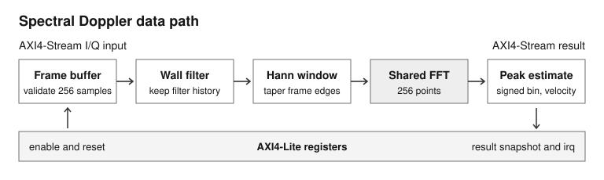
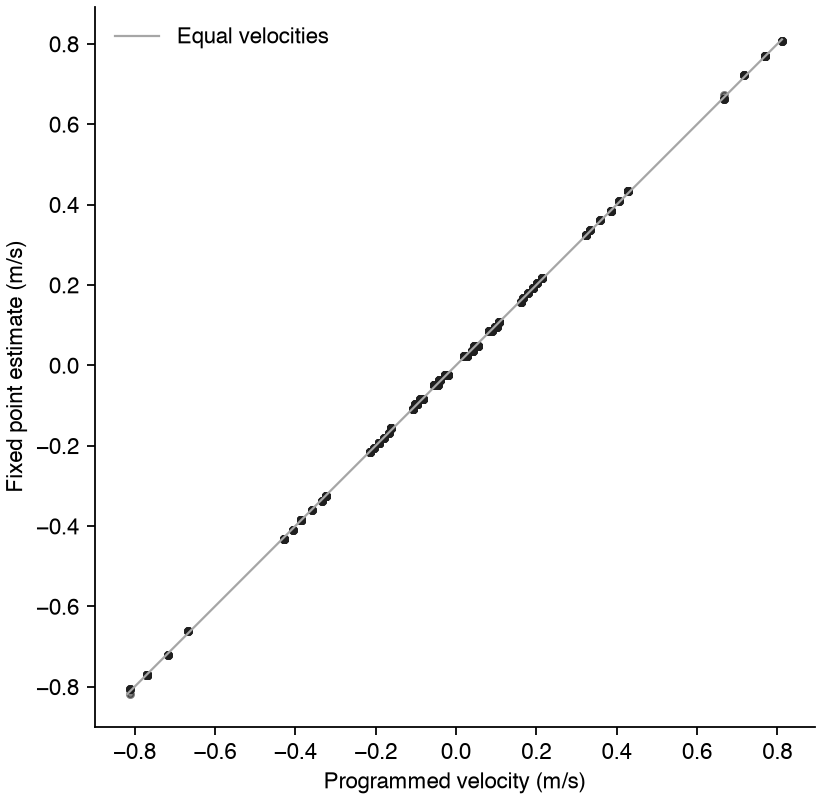

# FPGA Spectral Doppler Engine

In my cardiac flow research, Doppler measurements give us one component of the flow velocity. For this project I wanted to build the signal processing in hardware and see what would fit on an iCE40UP5K. I used synthetic I/Q so I could set the true frequency shift and check the result in both directions.



## See it run

Use Python 3.11 or newer and Icarus Verilog. Run these commands from the repository root.

```sh
python3 -m venv .venv
source .venv/bin/activate
python -m pip install -e . -r requirements-dev.txt
COCOTB_TEST_FILTER='all_directed_signed_bins_match_oracle$' python -m pytest -s tests/test_cocotb.py::test_doppler_core_cocotb
```

This runs ten signed tone cases through the SystemVerilog core. The test inserts input gaps and output stalls and checks each result against the bit-accurate Python model. Here are two lines from the simulation, with the simulator prefix omitted.

```text
rtl bin +16  +1250.00 hz  +192.50 mm/s   python bin +16  +1250.00 hz  +192.50 mm/s
rtl bin -16  -1250.00 hz  -192.50 mm/s   python bin -16  -1250.00 hz  -192.50 mm/s
```

## Two choices I made

1. **Check the entire frame before filtering it.** The wall filter carries its history between frames. Buffering all 256 samples lets me reject an early or missing end marker before it changes the filter state for the next frame.
2. **Reuse the FFT hardware.** I used an iterative FFT to fit the transform on the UP5K. The placed core uses all eight DSP blocks. The tradeoff is latency. With no stalls, the core took 15,622 cycles from the accepted last sample to a valid result.

The AXI version adds stream backpressure, a coherent last-result snapshot, soft reset, and a sticky interrupt. The [register map](docs/axi_lite_register_map.md) describes what happens when software pauses the stream or reads a result.

## What I measured

| Run | Result |
| --- | --- |
| [Python model sweep](docs/results_m1.md#algorithm-regression) | 1,800 synthetic configurations. Direction was correct for all scored frames at SNR of 20 dB or higher. |
| [AXI RTL simulation](docs/coverage_closure.md) | 100 randomized seeds. Targeted tests closed the remaining gaps, reaching 263 of 263 required functional and cross bins. |
| [iCE40 core place and route](docs/results_m1.md#up5k-implementation) | 4,068 of 5,280 logic cells. Closed the 12 MHz constraint. |
| [iCE40 offline UART top place and route](docs/results_m1.md#offline-board-top-demonstration) | 5,131 of 5,280 logic cells. Closed the 12 MHz constraint. |



The plot is from the Python model sweep. The iCE40 reports are for the core and the separate offline UART top. The AXI system has simulation and elaboration evidence. Physical UPduino validation is pending.

## Reproduce the reports

With the virtual environment active, run `scripts/run_checks.sh` for the regression and standalone RTL checks. Run `scripts/run_regression.py` for the Python sweep. The iCE40 reports use `scripts/build_core_resource.sh` and `scripts/build_board_top.sh` with Yosys and nextpnr.

The [architecture notes](docs/architecture.md) cover the core and offline UART path. The [verification plan](docs/verification_plan_v2.md), [bug log](docs/bug_log_v2.md), and [board checklist](docs/m2_board_validation_checklist.md) describe the remaining details.
