# Architecture

```mermaid
flowchart LR
  G["Deterministic Python generator"] --> O["Floating + bit-accurate oracle"]
  O --> V["Versioned vectors and regression results"]
  V --> S["Initialized sample source"]
  S --> C["256-sample frame checker"]
  C --> F["63/64 wall filter"]
  F --> W["Hann window"]
  W --> X["Iterative 256-point FFT / 256"]
  X --> P["Power and guarded peak search"]
  P --> M["Frequency and velocity mapping"]
  M --> R["Result packet + CRC-16"]
  R --> U["115200 UART"]
  U --> H["Python host decoder"]
```

The frame checker stores one complete frame before releasing it. Early or missing `last` therefore cannot modify the persistent wall-filter state. The FFT reuses two 256×16 memories and eight DSP blocks across 1,024 butterflies. Its eight stage shifts implement the exact `1/256` normalization.

The reusable `doppler_core` has no board pins or UART behavior. `board_top` is an offline demonstration wrapper using the UP5K internal oscillator; physical I/O mapping remains an M2 decision.

The sample source is declared as RTL memory. In the archived iCE40 implementation it does not add any EBR blocks relative to the core-only build and instead increases logic use, so the demonstrated path is described as initialized-memory-to-UART, not BRAM-to-UART.
